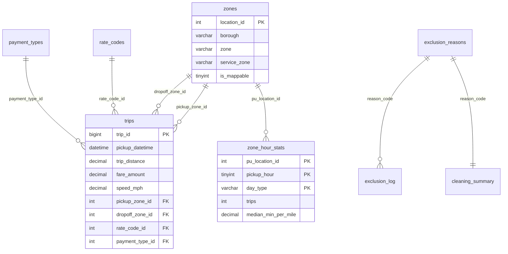

# Database schema

MySQL 8 (or a MySQL-compatible server such as MariaDB or Aiven MySQL), database `urban_mobility`. Files: `database/schema.sql` (tables), `database/indexes.sql` (indexes), `database/init_db.py` (creates the schema, fills the lookup tables, builds the indexes). Connection settings come from the environment variables `DB_HOST`, `DB_PORT`, `DB_USER`, `DB_PASSWORD`, `DB_NAME` (and optional `DB_SSL_CA`); no password is stored in the code.

## Entity-relationship diagram

## Tables
| Group | Table | Rows (full January load) | Purpose |
|---|---|---|---|
| Dimension | `zones` | 265 | One row per TLC LocationID with borough, zone, service zone, area, centroid and `is_mappable` (0 for zones 264/265 and zones without a polygon) |
| Dimension | `payment_types`, `rate_codes` | 6 / 7 | Code descriptions. Rate code 99 is kept so a foreign key never fails on other months |
| Fact | `trips` | 7,578,846 | Cleaned trips: raw columns, derived features, quality flags |
| Transparency | `exclusion_reasons`, `cleaning_summary`, `exclusion_log` | 20 / 20 / 98,524 | Every rule, how many trips it affected, and every removed trip |
| Aggregates | `zone_hour_stats`, `hour_stats`, `daily_stats` | about 10,500 / 48 / 58 | Cleaned and raw statistics for the dashboard |

`trips` columns: `trip_id` (row number in the raw file), `vendor_id`, `pickup_datetime`, `dropoff_datetime`, `passenger_count`, `trip_distance`, `pickup_zone_id`, `dropoff_zone_id`, `rate_code_id`, `payment_type_id`, `store_and_fwd`, `fare_amount`, `extra`, `mta_tax`, `tip_amount`, `tolls_amount`, `improvement_surcharge`, `congestion_surcharge`, `total_amount`; derived: `duration_min`, `speed_mph`, `min_per_mile`, `fare_per_min`, `fare_per_mile`, `pickup_date`, `pickup_hour`, `pickup_dow` (0 = Monday ... 6 = Sunday), `is_weekend`, `is_flat_fare`; flags: `flag_unknown_zone`, `flag_passenger_suspect`, `flag_low_speed`, `flag_total_mismatch` (0 or 1, never empty). The pipeline file uses different names for six columns; the loader maps them (`pickup_ts`, `dropoff_ts`, `trip_distance_mi`, `pu_location_id`, `do_location_id`, `avg_speed_mph`). The meaning of every column is in `docs/data_dictionary.md`.

## Design decisions
1. **Normalised categories.** Payment type and rate code live in lookup tables referenced by foreign keys. Borough and service zone depend on the zone, not on the trip, so they sit on `zones`. A separate borough table was rejected because there are only 7 boroughs.
2. **Derived features stored on the trip.** `duration_min`, `speed_mph`, `min_per_mile`, `fare_per_min`, `fare_per_mile` and the time columns depend on other columns. They are stored once at load time, so no query recomputes them over 7.6 million rows.
3. **Precomputed statistics.** MySQL has no median, and a median cannot be rebuilt from medians of sub-groups. `zone_hour_stats`, `hour_stats` and `daily_stats` are built in pandas (`pipeline/build_aggregates.py`) and hold cleaned and raw columns side by side, which powers the raw-versus-cleaned toggle. `is_reliable = 1` means at least 30 cleaned trips.
4. **Traceability.** `trip_id` equals the source row number, and `exclusion_log.source_row` uses the same numbering, so every kept or removed trip can be found in the raw file.
5. **Exclusion log without foreign keys on zones.** A removed record may carry an invalid zone id, so the raw values are stored as they are.
6. **Fare components kept.** Tip, tolls, extra, MTA tax, improvement and congestion surcharges are stored (nullable), so fare and fee analysis is possible even though the main story uses time-based features.

## Indexes (`database/indexes.sql`, created after the bulk load)
| Index | Serves |
|---|---|
| `idx_trips_pickup_time` on `trips(pickup_datetime)` | Date range filters and sorting by time |
| `idx_trips_zone_time` on `trips(pickup_zone_id, pickup_datetime)` | Zone drill-down |
| `idx_trips_route` on `trips(pickup_zone_id, dropoff_zone_id)` | Top routes (group by pickup and dropoff) |
| `idx_trips_date_hour` on `trips(pickup_date, pickup_hour)` | Date range and hour filters |
| `idx_trips_hour` on `trips(pickup_hour)` | Hour filter on its own |
| `idx_trips_fare`, `idx_trips_distance` | Fare and distance filters and sorting |
| Automatic foreign-key indexes (`dropoff_zone_id`, `rate_code_id`, `payment_type_id`) | Joins and destination filters |
| Primary keys on the statistics tables | Every map, chart and ranking query is a primary-key lookup |

## Trade-offs
- **Load speed vs query speed:** indexes are created after the load, because each index slows every insert.
- **Storage:** the trips table is about 0.8 GB before indexes (estimated from 1 million rows), so a cloud database with a small storage limit can only hold a sample. The loader's `--sample-every 20` keeps every 20th trip, spread over the whole month.
- **Sorting on non-indexed columns** (fare, distance, duration, speed) is slow on the full table; adding indexes would cost space. We indexed fare and distance (the two sorts the dashboard offers most), skipped duration and speed, and rely on the statistics tables for the dashboard.
- **Flagged rows are kept** (unknown zones, suspicious passenger counts, low speed, total mismatch); only impossible records are removed (88,946 trips, 1.16%).

## econ_hour (added for the economics slice)
One row per pickup hour and day type: `trips, avg_fare, avg_fees, avg_fare_per_mile, card_trips, card_tip_pct`. Built by `pipeline/build_aggregates.py` (`compute_economics`) and loaded by `pipeline/load_extras.py`. Primary key `(pickup_hour, day_type)`. The tip rate counts card payments only.
