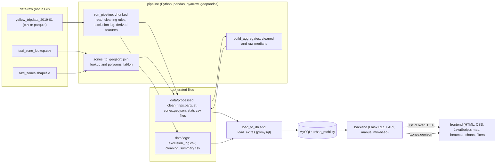

# System architecture

**Flow.** The pipeline reads the raw trips in chunks of 500,000 rows, applies 16 exclusion rules and 4 flag rules, writes every removed record to the exclusion log, derives features and converts the zone shapefile to lat/lon GeoJSON. `build_aggregates` then computes medians per zone, hour and day type, for cleaned and raw trips. The loaders fill MySQL (lookups, trips, exclusion tables, statistics). The Flask API reads the database; the dashboard only calls the API and never touches the database.

**Run order.** `run_pipeline` → `build_aggregates` → `init_db schema` → `load_to_db` → `load_extras` → `init_db indexes` → start the backend → start the frontend.

**Why this shape.**
- Chunked processing keeps memory low for 7.7 million rows.
- Parquet keeps column types between pipeline stages.
- Medians are precomputed because MySQL has no median function and grouping the full table on every click is too slow.
- One cleaning step feeds both the slowness views and the data-trust layer (raw versus cleaned).
- The database credentials are read from environment variables, so nothing secret is committed.
